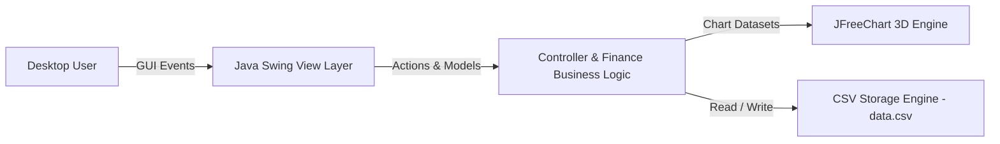

<div align="center">

  

  # 💸 MoneyFlow Pro
  
  **An intuitive, elegant, and secure desktop personal finance & cash flow tracking suite.**

  [](https://www.oracle.com/java/)
  [](https://docs.oracle.com/javase/tutorial/uiswing/)
  [](https://github.com/UnnamedPeople-Chin/Project-PBO-MoneyFlow/releases)
  [](LICENSE)
  [](https://github.com/UnnamedPeople-Chin/Project-PBO-MoneyFlow)

  <p align="center">
    <a href="https://github.com/UnnamedPeople-Chin/Project-PBO-MoneyFlow/releases"><strong>Download Windows Installer »</strong></a>
    <br />
    <br />
    <a href="#-key-features">Key Features</a> •
    <a href="#-visual-previews">Visual Previews</a> •
    <a href="#-system-architecture--tech-stack">Tech Stack</a> •
    <a href="#-getting-started">Getting Started</a> •
    <a href="#-team--credits">Team</a>
  </p>

</div>

---

## 📌 Executive Summary

**MoneyFlow Pro** is an offline-first desktop personal accounting solution engineered to simplify daily financial discipline. Developed as an exemplary Object-Oriented Programming (PBO) project, it tackles manual budget mismanagement through real-time balance calculations, custom transaction tagging, and rich 3D visualization. User privacy is safeguarded natively through local-file serialization without cloud tracking.

---

## ✨ Visual Previews

<table>
  <tr>
    <td width="50%" align="center">
      <b>Dashboard & Transaction Hub</b>
      <br/><br/>
      
      <br/>
      <em>Real-time income, expense, and net balance monitoring table.</em>
    </td>
    <td width="50%" align="center">
      <b>Interactive 3D Analytics</b>
      <br/><br/>
      
      <br/>
      <em>Multi-dimensional breakdown using 3D Pie & Bar charts.</em>
    </td>
  </tr>
</table>

---

## 🚀 Key Features

### 💰 Transaction & Ledger Management
- **Instant Entry**: Log daily incomes and expenses with timestamps, notes, and dynamic currency parsing.
- **Dynamic Categorization**: Group finances with pre-configured icons/emojis (Food, Bills, Education, Investments).

### 📊 Rich 3D Visual Analytics
- **3D Expense Breakdown**: High-contrast 3D pie charts indicating spending distribution.
- **Trend Analysis**: Comparative bar charts mapping monthly revenue vs expenditures.

### 🔒 Privacy-First Local Persistence
- **Zero Cloud Leak**: Full offline autonomy powered by robust CSV serialization.
- **Data Export & Portability**: Easy backup and inspection without external database drivers.

### 📦 Production Windows Installer
- **Turnkey Setup**: Includes a pre-compiled Windows executable (`.exe`) powered by Inno Setup with desktop shortcuts and uninstallation wizards.

---

## 🛠️ System Architecture & Tech Stack



| Layer | Technologies & Tools |
|---|---|
| **Core Language** | Java (JDK 11 or higher) |
| **GUI Framework** | Java Swing / AWT with customized Flat Look & Feel |
| **Data Visualization** | JFreeChart (3D Pie & Bar Charts) |
| **Persistence** | Flat-File CSV Serialization Engine |
| **Packaging & Distribution** | Inno Setup Compiler (Stand-alone `.exe` Installer) |

---

## 📂 Project Directory Structure

```text
├── src/                             # Java source packages (Model, View, Controller)
├── dist/                            # Compiled binaries & runnable artifacts
├── dist-installer/                  # Generated Windows installation packages
├── emojis/                          # Category icon assets
├── categories.csv                   # Category configuration dataset
├── data.csv                         # Local transactions database
├── build_jar.bat                    # Automation batch script to build JAR
├── build_app_image.bat              # Automation script for JPackage bundle
├── moneyflow_installer.iss          # Inno Setup compilation script
└── README.md                        # Documentation
```

---

## 💻 Getting Started

### Prerequisites
- [Java Development Kit (JDK) 11+](https://www.oracle.com/java/technologies/downloads/) installed and added to `PATH`.

### Quick Run (Source Code)
```bash
# 1. Clone repository
git clone https://github.com/UnnamedPeople-Chin/Project-PBO-MoneyFlow.git
cd Project-PBO-MoneyFlow

# 2. Build executable JAR
build_jar.bat

# 3. Launch application
java -jar MoneyFlow.jar
```

---

## 👥 Team & Credits

This project was developed collaboratively by the **PBO Engineering Team**:

<table>
  <tr>
    <td align="center" width="130px">
      <a href="https://github.com/UnnamedPeople-Chin">
        <br />
        <sub><b>Jizdan Yuflikh R</b></sub>
      </a><br />
      <sub>Lead Developer</sub>
    </td>
    <td align="center" width="130px">
      <a href="https://github.com/kfknfs">
        <br />
        <sub><b>Kafka Nafisa</b></sub>
      </a><br />
      <sub>UI/UX & Testing</sub>
    </td>
    <td align="center" width="130px">
      <a href="https://github.com/nzrlfrrs">
        <br />
        <sub><b>Nazriel Farras</b></sub>
      </a><br />
      <sub>Core Logic</sub>
    </td>
    <td align="center" width="130px">
      <a href="https://github.com/anisaaulia">
        <br />
        <sub><b>Anisa Aulia</b></sub>
      </a><br />
      <sub>Documentation & QA</sub>
    </td>
  </tr>
</table>

- **Lecturer / Mentor**: Bapak Arif Fitra Setyawan S.Pd., M.Kom.
- **Institution**: Politeknik Negeri Semarang (POLINES)

---
<div align="center">
  <sub>© 2026 MoneyFlow Pro. Designed with precision and clean architecture.</sub>
</div>
